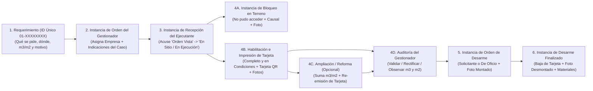

# Plan de Implementación: PWA de Gestión de Provisión de Andamios (ARAUCO)

Este plan define el desarrollo de una **Aplicación Web Progresiva (PWA)** instalable en celulares, tablets y PC, que digitaliza la planilla oficial **Solicitud de Provisión de Andamios (ARAUCO)** e incorpora la **trazabilidad por numeración única e impresión de Tarjeta de Identificación y Habilitación**, la separación operativa y contable entre **Andamios Anuales (Marcha Normal)** y **Andamios de Parada General (PGP)**, el **control de vencimiento a los 30 días corridos con pase a Alquiler**, las **instancias internas compartidas en la app entre Gestionador y Ejecutante**, el **registro histórico reutilizable ("Copiar Pedido")**, la **carga masiva por Excel** y el **Centro de Control Integral del Gestionador con Doble Certificación**.

---

## 1. Trazabilidad Total: Numeración Única, Habilitación en App e Impresión de Tarjeta

Para garantizar que cada estructura montada en planta sea 100% identificable y auditable desde que se solicita hasta que se desarma:

1. **Generador de Número Único e Irrepetible:**
   - Cada pedido genera automáticamente un **N° de Solicitud Oficial correlativo único** con formato `01-00005117` (tanto en carga manual como en importación masiva Excel) y un **ID Único de Tarjeta de Andamio (`HAB-01-00005117`)**.
   - El sistema bloquea cualquier duplicidad y mantiene el historial completo vinculado a ese código único.

2. **Marcado Oficial en la App: "Andamio Completo, en Condiciones y Habilitado":**
   - Cuando el **Ejecutor (Empresa de Servicio)** finaliza el montaje en terreno, carga las Dimensiones Reales ($m^3$/$m^2$), completa el **Checklist Reglamentario de 11 puntos de ARAUCO**, sube las fotografías y firma, activa en la app el estado oficial:
     > **🟢 ANDAMIO COMPLETO, EN CONDICIONES Y HABILITADO PARA USO**
   - Si algún punto crítico del checklist no se cumple, el sistema impide marcarlo como habilitado hasta que esté en condiciones seguras.

3. **Impresión de "Tarjeta de Identificación y Habilitación de Andamio" (Con Código QR):**
   - Al quedar marcado como completo y habilitado en la app, tanto el **Ejecutante** como el **Gestionador** pueden presionar el botón **"🏷️ Imprimir Tarjeta de Identificación"** (formato tarjeta industrial vertical lista para imprimir/plastificar y colocar en el andamio junto con la planilla completa):
     - **Encabezado Verde de Seguridad ARAUCO:** *"ANDAMIO HABILITADO — COMPLETO Y EN CONDICIONES"*.
     - **Número Único Grande y Visible:** `N° 01-00005117` / `TARJETA HAB-005117`.
     - **Código QR de Trazabilidad:** Permite escanear la tarjeta en planta para verificar en vivo en la app que el andamio está habilitado, ver sus fotos, medidas reales y fecha de vencimiento.
     - **Datos Técnicos en la Tarjeta:** Ubicación Técnica exacta, Sector, Centro de Costos, Solicitante, Empresa Ejecutora, Tipo de Andamio y Dimensiones Reales ($m^3$ y $m^2$).
     - **Fechas y Vigencia:** Fecha/Hora de Habilitación y Fecha de Vencimiento (30 días corridos).
     - **Certificación de Seguridad:** Resumen de los 11 puntos del checklist aprobados + **Firma Digital del Supervisor Andamista** y **Firma Supervisor ARAUCO**.

---

## 2. Separación Operativa y de Certificación: Anuales vs. Parada General

| Característica | 1. Andamios Anuales (Marcha Normal) | 2. Andamios en Parada General (PGP / Adicional PGP) |
| :--- | :--- | :--- |
| **Volumen y Modo de Carga** | Pedidos cotidianos individuales (y opción de planilla) para Mantenimiento y Producción anual. | Alto volumen de unidades por área. **Carga Masiva por Excel (`.xlsx` / `.csv`)** o reutilización de lotes de paradas anteriores. |
| **Regla de Permanencia y Alquiler** | **30 días corridos incluidos desde la habilitación.** Incluye contador regresivo y alertas al Solicitante. Si supera los 30 días sin pedir desarme, **pasa automáticamente a Alquiler** y notifica al usuario. | Seguimiento intensivo por ventana de Parada General (% de avance de montaje, habilitación y desmontaje). |
| **Esquema de Pago y Certificación** | **Tabla Oficial de 18 Ítems Tarifarios** (Cánones fijos, Andamios/Plataformas/Estructuras por día hábil, sábado/nocturno, domingo/feriado, **alquilados (>30 días)** e ítems especiales CR/CP). | **Certificación Directa PGP por Metraje Real:** Pago directo por **$m^3$ de Andamio realizado** y **$m^2$ de Plataformas realizadas**. |

---

## 3. Instancias Dentro de la Misma App (Vista Compartida Gestionador $\leftrightarrow$ Ejecutante)

---

## 4. Detalle Funcional por Módulo

### A. Módulo Solicitante (Anual, PGP Masivo, Control de 30 Días, Reformas, Desarme e Histórico)
1. **Sección 1 — Andamios Anuales (Marcha Normal):** Formulario oficial ARAUCO con N° correlativo único (`01-00005117`), cálculo automático de **Volumen ($m^3$)** y **Superficie ($m^2$)**, e ítems especiales CR/CP.
2. **Control de Vencimiento de 30 Días Corridos, Visualización de Habilitación y Solicitud de Desarme:**
   - Ve en tiempo real el sello **🟢 Andamio Completo y Habilitado**, su **Tarjeta Digital de Identificación**, las fotos del montaje y el contador regresivo de **30 días corridos** (con alerta previa y paso automático a **Alquiler** al día 31).
   - Opción de solicitar **"Ampliación / Reforma"** o presionar **"Indicar para Desarme"** (que abre la instancia de desarme en el panel del Gestionador).
3. **Sección 2 — Andamios Durante Parada General (PGP) y Carga Masiva Excel:**
   - Importador Excel (`.xlsx`, `.csv`) con asignación automática de IDs únicos correlativos a cada fila y **métricas de recepción del lote** (unidades totales, suma de $m^3$ y suma de $m^2$).
4. **Sección 3 — Registro Histórico, Métricas Propias y "Copiar Pedido Antiguo":**
   - Historial completo con métricas de cantidades y botón **"Copiar / Reutilizar Pedido"** (individual o por lote) generando nuevos números únicos sin volver a tipear.

---

### B. Panel del Gestionador de Andamios (Centro de Control Completo con los 7 Módulos Adicionales)
1. **Bandeja de Recepción, Aprobación y Carga de Indicaciones (Montajes y Reformas):**
   - Aprueba pedidos individuales o lotes PGP, asigna **Empresa Ejecutora**, redacta en la app las **Indicaciones de Ejecución del Caso** y despacha (en la app + opción WhatsApp y Hoja de Ruta PDF). Permite **reprogramar, anular o quitar pedidos**.
2. **Creación Directa de Órdenes por el Gestionador (Pedidos de Oficio / Urgencia):**
   - Alta directa de órdenes de Armado, Reforma o Desarme por parte del Gestionador con generación de ID único.
3. **Tablero de "Parque de Andamios Activos en Planta", Trazabilidad de Tarjetas y Desarme de Oficio:**
   - Inventario vivo buscable por **N° Único (`01-XXXXXXXX`)**, **N° de Tarjeta (`HAB-XXXXXX`)**, **Sector / Caldera**, **Centro de Costos**, **Empresa** y **Días montado**.
   - Permite reimprimir cualquier **Tarjeta de Identificación** o disparar una **Orden de Desarme de Oficio** en un clic (adjuntando la foto del andamio montado).
4. **Bandeja de Instancias de Desarme (Con Foto de Ubicación, Indicaciones y Control de Material):**
   - Asigna el desarme al equipo de armado adjuntando la **Foto del Andamio Montado**, su ID único de tarjeta y las indicaciones del caso.
5. **Mesa de Validación, Rectificación u Observación Pre-Certificación:**
   - Audita las medidas reales ($m^3$/$m^2$), fotos y habilitación con 3 acciones: `✅ Validar m³/m² y Habilitación`, `✏️ Rectificar Medidas / Ítem Tarifario` o `↩️ Observar / Devolver al Ejecutante`.
6. **Sección de Certificación con 2 Pestañas + Tarifarios y Control de Presupuesto:**
   - **Pestaña 1 — Certificación Anual / Marcha Normal (18 Ítems Oficiales):**
     1. `Canon Fijo Mantenimiento`
     2. `Canon Fijo Producción`
     3. `Andamios Nuevos (días hábiles)`
     4. `Andamios Nuevos Sábados y Nocturno`
     5. `Andamios Nuevos Domingo y Feriado`
     6. `Andamios Alquilados`
     7. `Plataformas (días hábiles)`
     8. `Plataformas Sábados y Nocturno`
     9. `Plataformas Nuevos Domingo y Feriado`
     10. `Plataformas (alquilados)`
     11. `Estructuras (días hábiles)`
     12. `Estructuras Nuevos Sábados y Nocturno`
     13. `Estructuras Nuevos Domingo y Feriado`
     14. `Estructuras (alquilados)`
     15. `Pisos de seguridad INF CR`
     16. `Pisos de seguridad SUP CR`
     17. `Pisos de seguridad CP`
     18. `Entablonado Grilla móvil CP`
   - **Pestaña 2 — Certificación de Parada General (PGP por $m^3$ y $m^2$):** Liquidación directa por **$m^3$ de Andamio realizado** y **$m^2$ de Plataformas realizadas**.
   - **Tarifarios y Control de Presupuesto** por Centro de Costos y Sector.
7. **KPIs de Desempeño (SLA e Impedimentos), Galería Central HSE y ABM de Usuarios/Empresas.**

---

### C. Portal de la Empresa de Servicio / Ejecutante (Habilitación e Impresión de Tarjeta)
1. **Tablero de Instancias Asignadas ("Para Armar", "Reformas", "Observados" y "Para Desarmar"):**
   - Visualiza el **N° Único del Andamio**, **Qué pide el Solicitante** y **Qué indica el Gestionador**, con botones **"Confirmar Recepción de Orden"** $\rightarrow$ **"Iniciar Trabajo en Sitio"**.
2. **Instancia de Montaje, Habilitación en App e Impresión de Tarjeta:**
   - **Opción 1 — Reportar "No se pudo acceder / Área sin condiciones"** con causal, comentario y foto.
   - **Opción 2 — Completar y Habilitar Andamio:**
     - Carga multifila de **Dimensiones Reales ($m^3$ y $m^2$)** y **Declaración de Régimen Horario Real e Ítem Especial**.
     - Llenado del **Checklist de Habilitación (11 puntos de ARAUCO)**.
     - **Check Oficial en App:** *"Declaro que el andamio está COMPLETO, EN CONDICIONES SEGURAS y HABILITADO"*.
     - **Generación Automática del N° Único de Tarjeta (`HAB-01-XXXXXXXX`)** + botón directo **"🏷️ Imprimir Tarjeta de Identificación de Andamio (con QR)"** para colocar en la estructura.
     - **Subida de Fotos** (Andamio Montado + Tarjeta Colocada) y **Firma del Supervisor Andamista**.
3. **Instancia de Modificaciones / Ampliaciones / Reformas:** Suma de $m^3$/$m^2$ adicionales y re-emisión de la Tarjeta de Identificación actualizada.
4. **Instancia de Desarme Guiado por Foto + Baja de Tarjeta + Reporte de Materiales:** Ubicación con **Foto del Andamio Montado** y su N° Único de Tarjeta, subida de **Foto del Andamio Desmontado**, baja automática de la habilitación y selector de estado de materiales.
5. **Panel "Mi Producción / Metraje Ejecutado":** Resumen de la contratista con $m^3$ y $m^2$ acumulados.

---

## 5. Plan de Construcción en `c:\Andamio`

1. **Base de Datos y Servidor PWA:** Persistencia completa con generador de numeración única correlativa (`01-XXXXXXXX`) e ID de tarjeta (`HAB-01-XXXXXXXX`), instancias operativas, regla de 30 días, tablas de metraje ($m^3$/$m^2$), 18 ítems de certificación + PGP, checklist, firmas y fotografías.
2. **Sistema de Autenticación y Control de Acceso por Perfil (Seguridad y Privacidad Estricta):** Acceso individual restringido por correo corporativo y contraseña propia para cada usuario. Eliminación de accesos directos públicos y switchers globales. Cada perfil (Solicitante Mantenimiento/Producción, Gestionador ARAUCO, Contratistas) visualiza estrictamente su alcance operativo asignado, protegiendo la confidencialidad de pedidos, certificaciones y órdenes de trabajo, con soporte de cambio de contraseña individual.
3. **Módulo Solicitante:** Alta anual, importador Excel PGP con métricas de recepción, monitor de 30 días con alertas de alquiler, vista de tarjeta de habilitación, solicitud de reforma/desarme e histórico con **"Copiar Pedido"**.
4. **Centro de Control del Gestionador:** Programación y órdenes de oficio, parque activo en planta con trazabilidad de tarjetas y desarme de oficio, mesa de validación/rectificación/observación de $m^3$/$m^2$, doble certificación + tarifarios/presupuesto, KPIs, galería HSE y ABM.
5. **Módulo Empresa Ejecutora + Impresor de Tarjeta de Identificación (QR) + Planilla Oficial ARAUCO (PDF):** Ejecución en terreno, marcado de *"Completo y en Condiciones"*, **generación e impresión de la Tarjeta de Identificación de Andamio**, fotos de montado/desmontado, panel "Mi Producción" y PDF oficial de la Solicitud de Provisión de Andamios.
6. **Trazabilidad en Terreno 360° & Mesa de Auditoría Pre-Certificación (Etapa 6 - Completada):**
   - **Generador de QR Vectorial Real (SVG)**: Impresión de tarjetas con código QR 100% escaneable desde celulares en planta.
   - **Página Pública de Auditoría en Terreno (`/verificar.html?id=...`)**: Acceso directo para personal de seguridad HSE y supervisores sin requerir inicio de sesión, mostrando semáforo en vivo de permanencia de 30 días, checklist de 11 puntos, fotos de montaje y metraje auditado.
   - **Mesa de Auditoría Técnica del Gestionador**: Pestaña dedicada con acciones para `✅ Validar m³/m²`, `✏️ Rectificar Medidas` (con historial del metraje previo y justificación) y `↩️ Observar` (notificación de no conformidades).
   - **Gestión de Reformas / Ampliaciones**: Registro y aprobación de modificaciones en andamios activos sumando volumen y superficie adicionales.
7. **Administrador General ARAUCO & Sistema de Recuperación de Contraseñas (Completado):**
   - **Cuenta Administrador General**: Configuración del usuario `diego.a.cristaldo@arauco.com` con rol `GESTIONADOR` (privilegios plenos de control, despacho, auditoría y certificación).
   - **Sistema de Recuperación por PIN**: Flujo de restablecimiento seguro en 2 pasos con verificación de correo corporativo, código PIN temporal de 6 dígitos con expiración de 15 minutos y confirmación de nueva clave.
